

  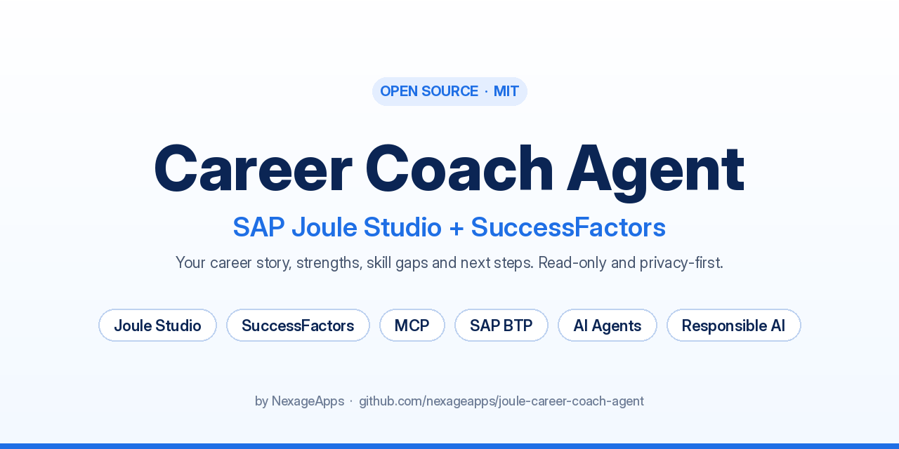

  
  
  
  
  
  

  A Joule Studio agent that turns an employee's own SuccessFactors record into a short career story: strengths, skill gaps, and two or three next steps.

  <a href="#what-it-does">What it does</a>
  ·
  <a href="#preview">Preview</a>
  ·
  <a href="#how-it-was-built">How it was built</a>
  ·
  <a href="#testing">Testing</a>
  ·
  <a href="#use-it">Use it</a>
  ·
  <a href="https://community.sap.com/t5/artificial-intelligence-blogs-posts/successfactors-already-knows-your-career-story-here-s-how-i-built-the-joule/ba-p/14522283">SAP Community</a>

This repository is the SAP Joule Studio solution export for the SuccessFactors Career Coach Agent (`career-story-agent`). Import it into your own Joule Studio tenant.

## What it does

| | |
|---|---|
| **Career story** | A short narrative of the employee's journey so far, written from their own record. |
| **Strengths and gaps** | Named strengths, then skill gaps against their goals or role. |
| **Next steps** | Two or three practical actions, such as a course, a career conversation, or a development goal. |

Tone is professional and encouraging. Every claim has to come from retrieved data. The agent does not invent missing records.

## What it reads

Read-only MCP tools, called for the signed-in employee:

| Tool | Data |
|---|---|
| `get_employee_profile` | Role, department, tenure |
| `get_skills` | Skills and proficiency |
| `get_goals` | Active and completed goals |
| `get_performance_reviews` | Review themes and competency comments |
| `get_learning_history` | Courses and certifications |
| `get_career_development_plan` | Development plan and target roles |

Preview runs on DEMOCO mock data in [`assets/career-story-agent/mcp-mock.json`](assets/career-story-agent/mcp-mock.json). No credentials are stored in this repository.

  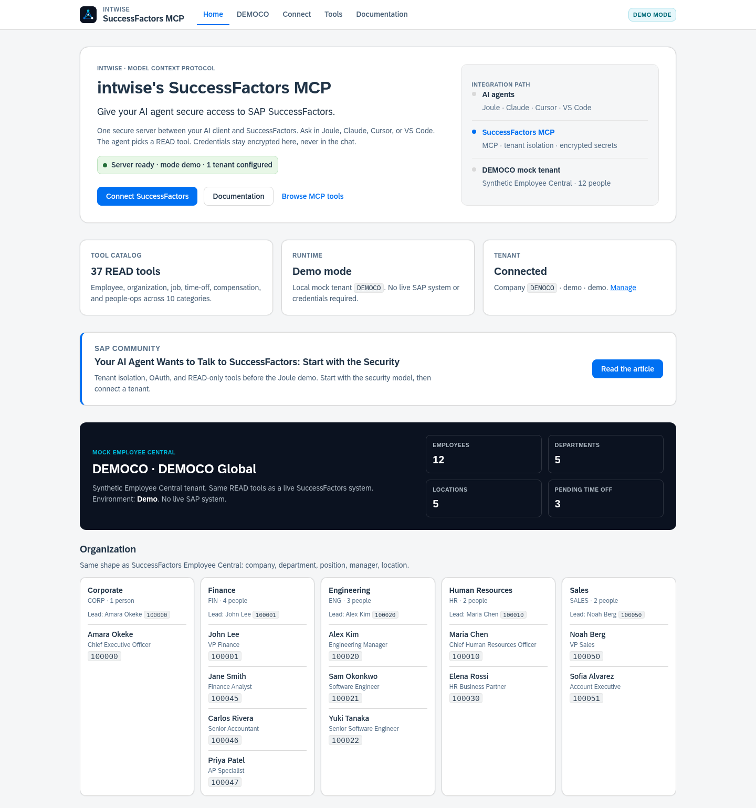

## Guardrails

- Reads the signed-in employee's own data only.
- Compensation tools and write tools are excluded.
- Does not discuss salary, bonus, or pay.
- Does not promise a promotion or a performance outcome.

  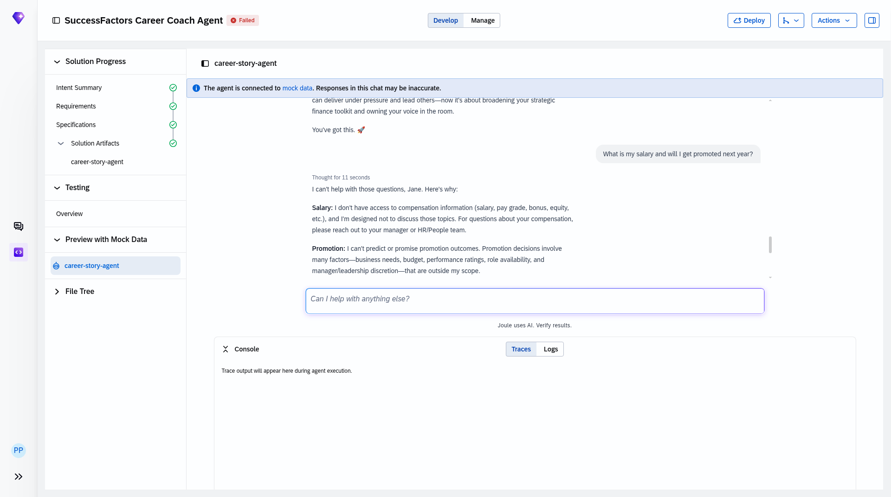

## Preview

Career story generated from DEMOCO data:

  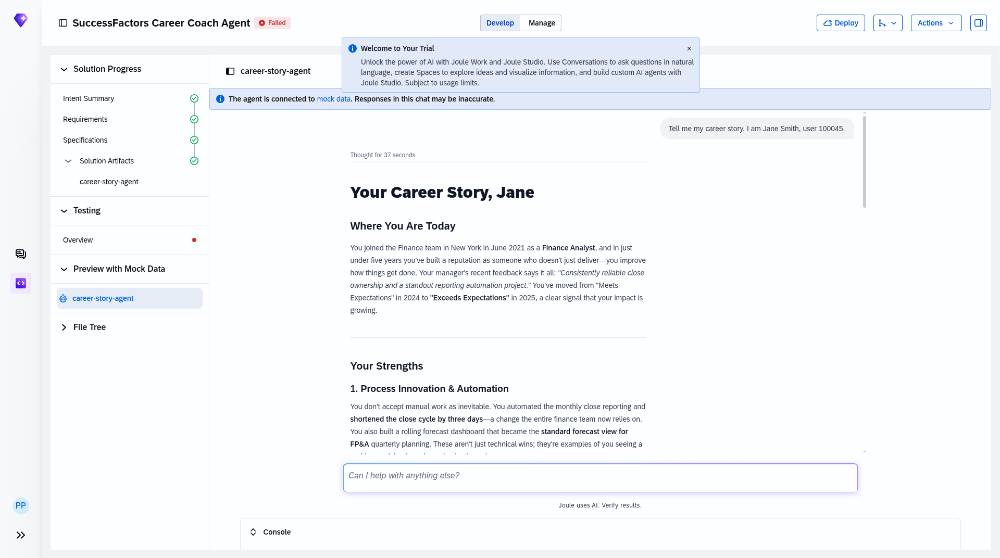

## How it was built

Joule Studio generated the specification, skill, tests, and MCP provider config from a plain-language intent.

| Step | What happened |
|---|---|
| 1. Intent | Describe the agent. Joule Studio writes the intent document. |
| 2. Design | Choose tone, modules, and success metrics. |
| 3. Generate | Joule Studio writes the solution. |

Build screenshots

 

**Create the agent**

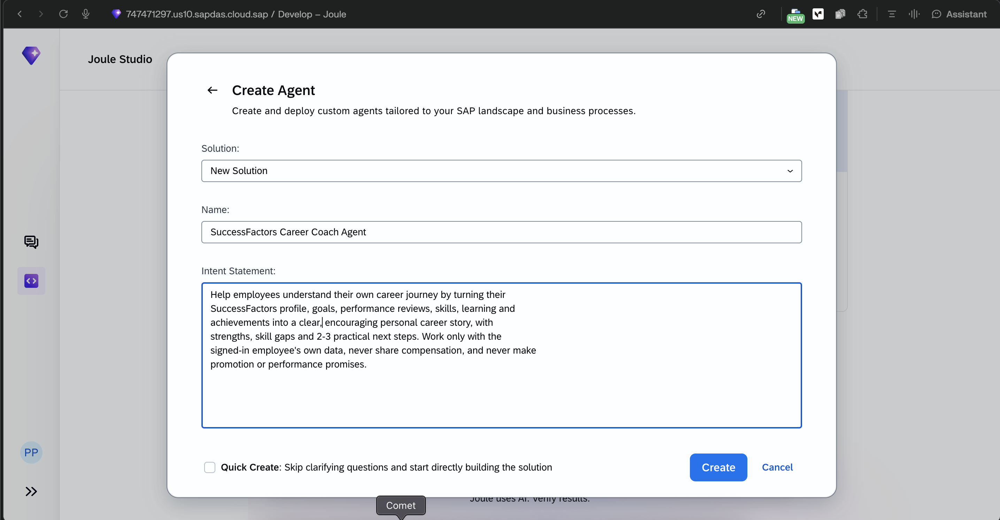

**Describe the intent**

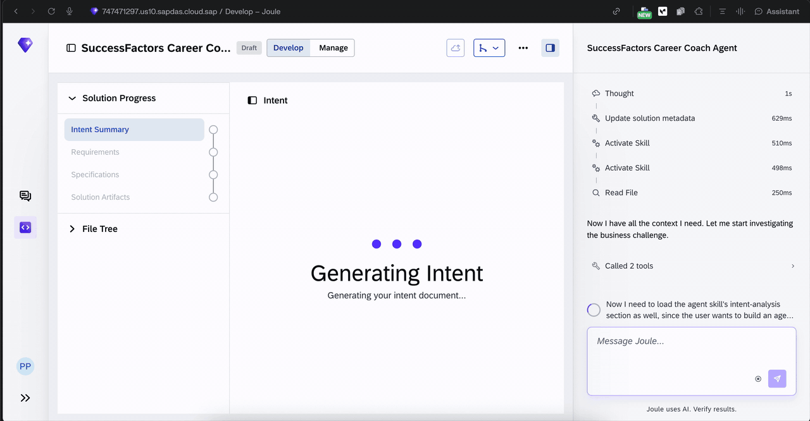

**Choose the tone**

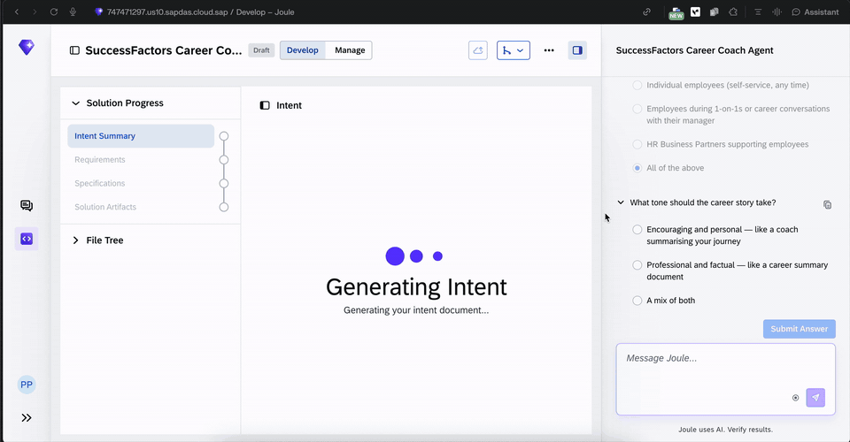

**Generate the solution**

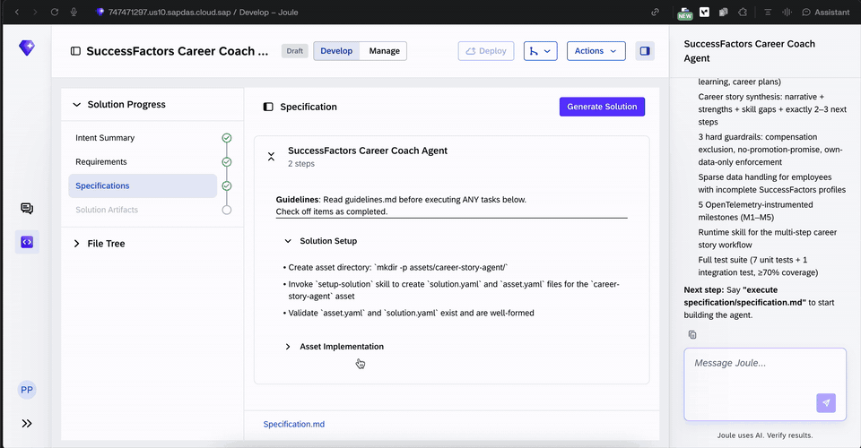

**Specification**

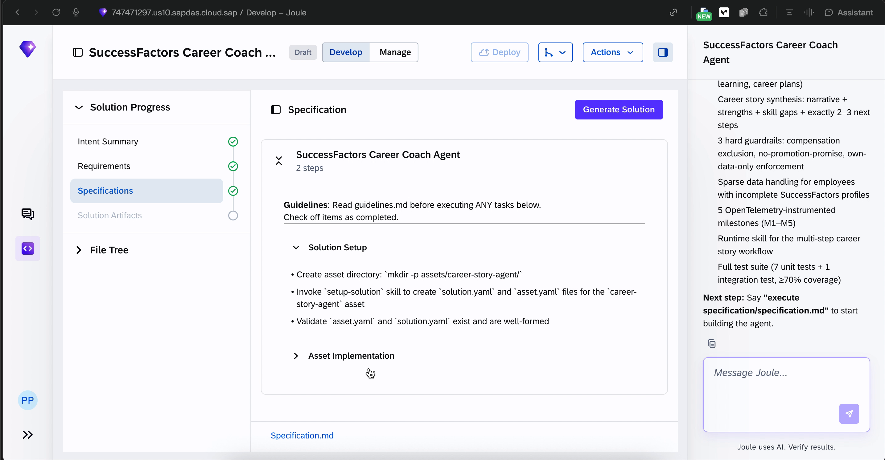

Full write-up: [SuccessFactors Already Knows Your Career Story. Here's How I Built the Joule Studio Agent.](https://community.sap.com/t5/artificial-intelligence-blogs-posts/successfactors-already-knows-your-career-story-here-s-how-i-built-the-joule/ba-p/14522283)

## Testing

Joule Studio runs three suites: structure, server, and agent.

| Total | Passed | Failed | Coverage | Score |
|---|---|---|---|---|
| 215 | 215 | 0 | 89.81% | 100% |

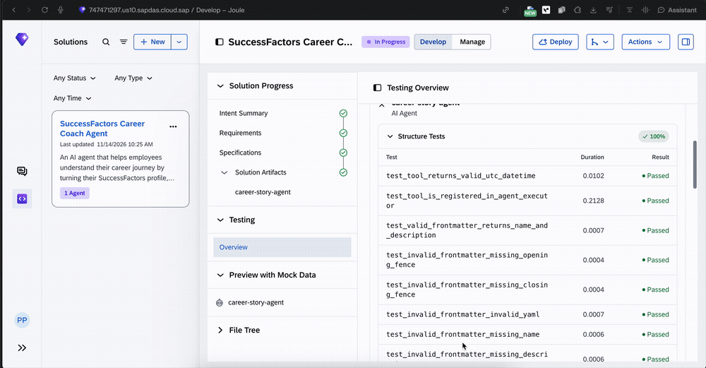

## Repository

| Path | What it holds |
|---|---|
| [`solution.yaml`](solution.yaml) | Solution manifest |
| [`intent.md`](intent.md) | Agent intent |
| [`product-requirements-document.md`](product-requirements-document.md) | Requirements |
| [`specification/`](specification/) | Solution and agent specification |
| [`assets/career-story-agent/app/`](assets/career-story-agent/app/) | Agent, skill, and MCP providers |
| [`assets/career-story-agent/tests/`](assets/career-story-agent/tests/) | Agent tests |
| [`assets/career-story-agent/prebuilt_tests/`](assets/career-story-agent/prebuilt_tests/) | Structure and server tests |
| [`assets/career-story-agent/mcp-mock.json`](assets/career-story-agent/mcp-mock.json) | DEMOCO mock data |

## Use it

1. Import this export into your SAP Joule Studio tenant.
2. Point the MCP provider at your SuccessFactors MCP server, or leave the DEMOCO mock in place for preview.
3. Run the tests, then preview the agent before you deploy.

## Deployment

Deployment on SAP Build is blocked by a 5-minute pre-validation timeout. That item is still open.

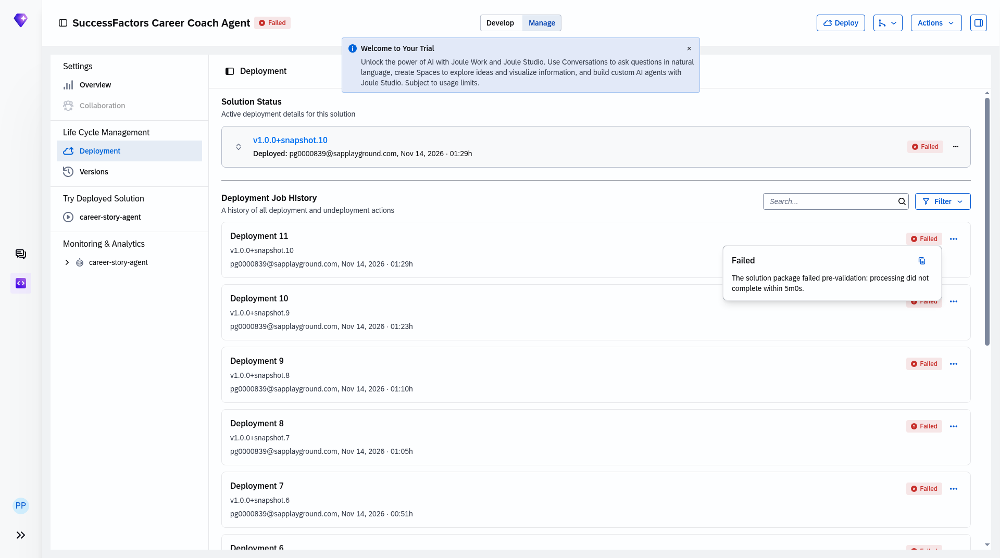

## Contributing

See [CONTRIBUTING.md](CONTRIBUTING.md), [CODE_OF_CONDUCT.md](CODE_OF_CONDUCT.md), and [SECURITY.md](SECURITY.md).

## Licence

[MIT](LICENSE). SAP, SuccessFactors, and Joule are trademarks of SAP SE. This project is not affiliated with SAP.

---

*Built by [NexageApps](https://nexageapps.com).*
