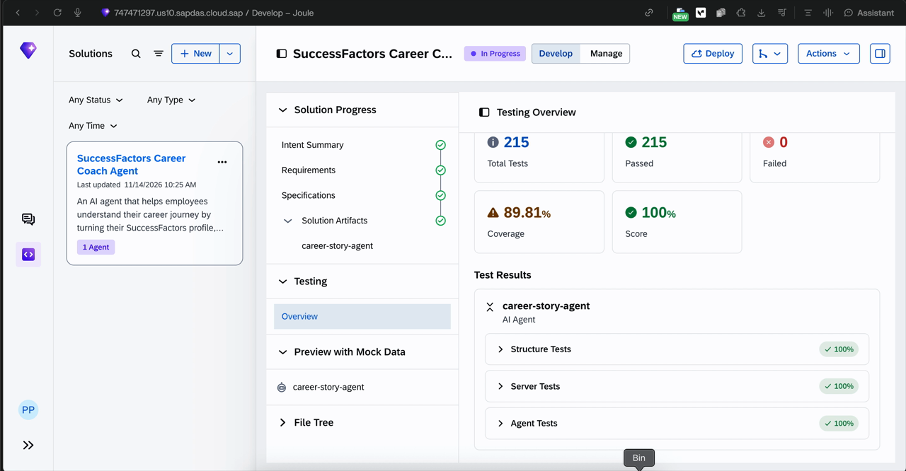

  

<h1 align="center">Career Coach Agent</h1>

A Joule Studio export that turns an employee's own SuccessFactors record into a short career story.

  

This repository is the SAP Joule Studio solution export for the SuccessFactors Career Coach Agent (`career-story-agent`). The agent reads the signed-in employee's profile, goals, performance reviews, skills, learning and development plan, then writes a personalised story with strengths, skill gaps, and two or three next steps.

Preview in this export uses DEMOCO mock data. This project is not affiliated with SAP.

## What it does

An employee asks for their career story. The agent answers from that person's own record:

- Where they are now
- Strengths and skill gaps
- Two or three next steps, such as a learning item, a career conversation, or an update to a development goal

The tone is professional and encouraging. Each claim has to come from the retrieved record. Compensation, promotion decisions and performance ratings stay out of the answer. The export is imported into a Joule Studio tenant.

## How it works

[`solution.yaml`](solution.yaml) is the solution manifest. The agent, its skill and its MCP provider config live under [`assets/career-story-agent/`](assets/career-story-agent/).

The skill calls six read-only MCP tools for the signed-in employee:

| Tool | Data |
| --- | --- |
| `get_employee_profile` | Role, department, tenure |
| `get_skills` | Skills and proficiency |
| `get_goals` | Active and completed goals |
| `get_performance_reviews` | Review themes and competency comments |
| `get_learning_history` | Courses and certifications |
| `get_career_development_plan` | Development plan and target roles |

In preview, those tools read [`assets/career-story-agent/mcp-mock.json`](assets/career-story-agent/mcp-mock.json). Credentials are not stored in this repository. Missing records stay missing.

Joule Studio built the export in three steps.

**1. Describe the intent.** A plain description becomes the intent document.

  

**2. Answer the design questions.** Tone, modules and success metrics.

  

**3. Generate the solution.** Joule Studio writes the specification, skills, tests and MCP provider config.

  

A longer account of the build is on SAP Community: [SuccessFactors Already Knows Your Career Story. Here's How I Built the Joule Studio Agent.](https://community.sap.com/t5/artificial-intelligence-blogs-posts/successfactors-already-knows-your-career-story-here-s-how-i-built-the-joule/ba-p/14522283)

## Repository layout

| Path | What it holds |
| --- | --- |
| [`solution.yaml`](solution.yaml) | Joule Studio solution manifest |
| [`intent.md`](intent.md) | The agent's intent |
| [`product-requirements-document.md`](product-requirements-document.md) | Generated requirements |
| [`specification/`](specification/) | Solution and agent specification |
| [`assets/career-story-agent/app/`](assets/career-story-agent/app/) | Agent app, skills and MCP providers |
| [`assets/career-story-agent/tests/`](assets/career-story-agent/tests/) | Agent tests |
| [`assets/career-story-agent/prebuilt_tests/`](assets/career-story-agent/prebuilt_tests/) | Structure and server tests |
| [`assets/career-story-agent/mcp-mock.json`](assets/career-story-agent/mcp-mock.json) | DEMOCO mock data for preview |
| [`docs/images/`](docs/images/) | Screenshots in this README |
| [`.github/`](.github/) | Issue and pull request templates |

## Mock data and guardrails

Preview uses the DEMOCO company in [`assets/career-story-agent/mcp-mock.json`](assets/career-story-agent/mcp-mock.json). The preview screenshots use Jane Smith (user 100045) from that mock. Real employee data is not stored here.

The agent is limited to read-only tools. Compensation tools and write tools are excluded. It reads only the signed-in employee's own data, and salary, promotion outcomes and performance promises stay outside its scope.

## Testing

Joule Studio generated and ran three suites: structure tests (45), server tests (2) and agent tests (168).

| Total tests | Passed | Failed | Coverage | Score |
| --- | --- | --- | --- | --- |
| 215 | 215 | 0 | 89.81% | 100% |

  

## Preview

| Career story from DEMOCO data | Guardrail on salary and promotion |
| --- | --- |
|  |  |

## Deployment status

Deployment on SAP Build is currently blocked by a 5-minute pre-validation timeout. The package fails because processing did not complete within 5m0s. That is still an open item.

  

## Use it

1. Import the export into your own SAP Joule Studio tenant.
2. Point the MCP provider at your own SuccessFactors MCP server, or keep the mock for preview.
3. Run the tests, then preview before you deploy.

## Contributing

See [CONTRIBUTING.md](CONTRIBUTING.md), [CODE_OF_CONDUCT.md](CODE_OF_CONDUCT.md) and [SECURITY.md](SECURITY.md).

Open an issue or a pull request with what you expected, what happened, and how to reproduce it. Leave out credentials, tokens and real employee data. Use DEMOCO mock data only.

## Licence

[MIT](LICENSE). SAP, SuccessFactors and Joule are trademarks of SAP SE. This project is not affiliated with SAP.

---

*Built by [NexageApps](https://nexageapps.com).*
